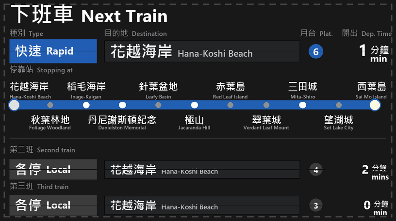
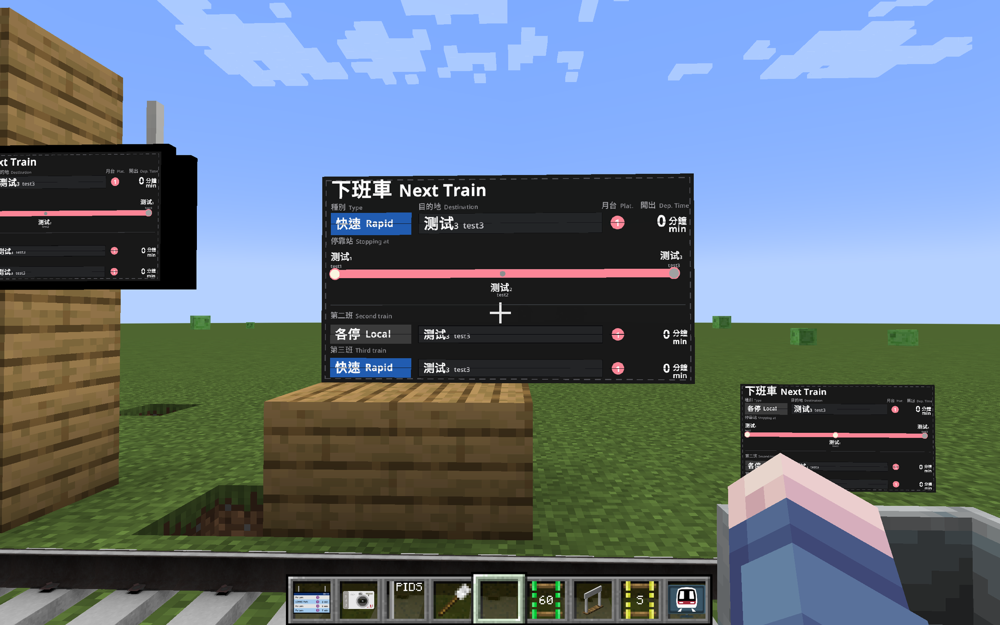

# HKR Split-Flap Display

[中文](README.md) | **English**

A split-flap-display style MTR PIDS resource pack for JCM (Joban Client Mod) — a recreation of the
flip display on the **Hana-Koshi Line** on the official MTR server.



**In-game screenshot** (three service types on one screen — note the split-flap seams,
the per-service badge colours and the line diagram):



---

## Origin & Credits

This pack recreates the split-flap display found on the **Hana-Koshi Line (花越线)** platforms,
built by **Forest_E233** on the **official MTR server (MTR Let's Play)**.

- Server wiki: <https://wiki.minecrafttransitrailway.com/zh:mtr_letsplay:start>
- The original screen is **3:2**
- Joban Client Mod's PIDS canvas is **2:1** (136 × 76 design units)

> **Because of the different aspect ratio, the layout differs slightly.**
> Elements had to be re-arranged for the 2:1 canvas; font sizes, row heights,
> baselines and badge widths in this pack were calibrated item by item against
> reference screenshots so that the 2:1 rendering stays as close as possible to
> the 3:2 original.

MTR and Joban Client Mod are the work of their respective authors.
This project is not affiliated with either of them.

---

## Installation

1. Drop `HKR-Split-Flap-Display.zip` into `.minecraft/resourcepacks/`
   (**do not unzip**, and do not leave an extra folder level inside)
2. Enable it in **Options → Resource Packs**
3. Place a JCM PIDS block, right-click it, and under **Custom PIDS Option**
   choose **HKR Split-Flap Display**
4. After editing script settings, press **F3 + T** to reload the pack

### Supported blocks

Only **JCM's PIDS blocks** are supported:

`jsblock:rv_pids`, `rv_pids_sil_1`, `rv_pids_sil_2`, `lcd_pids`, `pids_projector`, `pids_1a`

> **MTR's built-in `mtr:pids_1` … `pids_4` will NOT work** — those blocks don't
> support scripted presets.

## Requirements

| Mod | Version |
| --- | --- |
| Minecraft | 1.19.4 – 1.21 |
| Minecraft Transit Railway (MTR) | 4.x |
| Joban Client Mod (JCM) | 2.x |

---

## What it displays

| Area | Content |
| --- | --- |
| **Title** | 下班車 Next Train |
| **種別 Type** | Service-type badge (Chinese + English), colour-coded per service |
| **目的地 Destination** | Terminus name (bilingual), from MTR data |
| **月台 Plat.** | Platform-number circle, tinted with the MTR route colour |
| **開出 Dep. Time** | Under 10 minutes: countdown `N 分鐘`; 10 minutes or more: real-world clock `xx:xx` |
| **停靠站 Stopping at** | Full line diagram: grey dot = not served, lit white = served, breathing light on the terminus, large dot on the current station |
| **第二班 / 第三班** | The next two trains |

### Split-flap details

The reference is a split-flap display, so this pack reproduces its visual traits:

- **Centre seam** — a thin dark horizontal line through the middle of every cell
  (measured pixel by pixel from the `00:18` digits in the reference)
- **Flip animation** — when the content changes, the top flap falls while the
  bottom half **stays put**, exactly like a real split-flap unit
- **Flip sound** — a "clack" on each flip, positionally attenuated and globally rate-limited

---

## Route number / service type reference

**This is the part you will most likely want to change.** The badge text and colour
come from the `SERVICE_OVERRIDE` table at the top of
`assets/jsblock/scripts/next_train.js`.

### Recommended MTR route naming

MTR route names use the format `Chinese|English`, and a double pipe `||` marks a note.
**Put the service type in the route name or route number** and the script picks it up:

| Type | 中文 | English | Badge colour | Suggested route name / number | Matched keywords |
| --- | --- | --- | --- | --- | --- |
| 特急 | 特急 | Spec.press | `#D32F2F` red | `特急\|Spec.press` | `特急` |
| 準急 | 準急 | Semi Exp. | `#27AE60` green | `準急\|Semi Exp.` | `準急`, `Semi Exp.` |
| 特快 | 特快 | Special Rapid | `#453EA5` purple | `特快\|Special Rapid` | `特快` |
| 通快 | 通快 | Com.Rapid | `#0E9E9E` teal | `通快\|Com.Rapid` | `通快`, `Com.Rapid` |
| 急行 | 急行 | Ex.press | `#E67E22` orange | `急行\|Ex.press` | `急行`, `Ex.press` |
| 快速 | 快速 | Rapid | `#215DB3` blue | `快速\|Rapid` | `快速` |
| 各停 | 各停 | Local | `#3C3C3C` grey | `各停\|Local` | `各停` |

**Any of these places works:**

- In the route **name** → `特急|Spec.press`
- In the route **number** → recognised just the same (the name can even be `test`)
- In a `||` note → `花越线|Hana Line||特急|Spec.press`
- **Direction words are ignored automatically** — `快速|Rapid||上行` still shows
  "快速 Rapid" instead of treating 上行 (up direction) as a service type.
  Direction is meaningless on a PIDS: which platform you are on already determines it.

Selection rule: **if the name is empty, or the name doesn't look like `Chinese|English`
while the number does, the number is used; otherwise the name is used.**
To force one of them, set `SERVICE_LABEL_FROM` to `"name"` or `"number"`.

### Custom mapping table

If you don't want to depend on MTR naming, hard-code it in the script:

```js
const SERVICE_OVERRIDE = [
    { name: ["特急"],                color: "D32F2F" },  // red
    { name: ["準急", "Semi Exp."],   color: "27AE60" },  // green
    { name: ["特快"],                color: "453EA5" },  // purple
    { name: ["通快", "Com.Rapid"],   color: "0E9E9E" },  // teal
    { name: ["急行", "Ex.press"],    color: "E67E22" },  // orange
    { name: ["快速"],                color: "215DB3" },  // blue
    { name: ["各停"],                color: "3C3C3C" }   // grey

    // Match by route number
    // { number: "507", zh: "各停", en: "Local", color: "00A650" },
    // Hard-code the text too
    // { name: ["普通"], zh: "普通", en: "Ordinary", color: "7F8C8D" }
];
```

- Matched top to bottom, **first hit wins** (put more specific entries first)
- `name` may be a **string** or an **array**; any element matching counts as a hit
- `number` must match the route number **exactly**
- **If you only set `color`, the badge text still comes from the route name / `||` note**

### How to set up express services in MTR

MTR has **no concept of "local vs express"**. An express service is simply
**a separate route with a different platform list**:

1. Create a separate route for "Rapid"
2. **Add only the platforms it stops at** — the ones you leave out are passed through
3. Skipped stations show up as **grey dots** on the line diagram

| Route | Platforms | Line diagram |
| --- | --- | --- |
| 各停 Local | all 11 | every dot lit white |
| 快速 Rapid | only 6 | the 5 skipped stations are grey |
| 特急 Spec.press | only 4 | the 7 skipped stations are grey |

> Grey vs. white is determined **entirely** by that route's platform list —
> **no script changes needed**.

---

## Customisation

Every tunable lives at the top of the script, in this order:

| Setting | Purpose |
| --- | --- |
| `SS` | Supersampling factor (default 8 → 1088×608 texture) |
| `C_*` | Full colour palette |
| `SERVICE_OVERRIDE` | Service-type mapping table (see above) |
| `SERVICE_LABEL_FROM` | Take service text from name or route number |
| `SERVICE_IGNORE_EXTRA` | Direction words to ignore |
| `BADGE_*` | Badge width, font size, wrapping, italics |
| `LABELS` | Every hard-coded string on screen |
| `COUNTDOWN_WITHIN_MINUTES` | Countdown / clock threshold (default 10 minutes) |
| `TIME_SOURCE` | Base time on arrival or departure |
| `SEAM_*` | Split-flap seams |
| `FLIP_*` | Flip animation and sound |
| `TERMINAL_LED_*` | Terminus breathing light |
| `STOP_BLINK_*` | Stopping-station white light |
| `CURRENT_STATION_MARK` | Draw a large dot on the current station |
| `BAR_COLOR_FROM` / `PLATFORM_COLOR_FROM` | Which colour the line bar / platform circle uses |
| `L` | The whole layout geometry |
| `F_CJK` / `F_LATIN` / `F_MONO` | Font families |

### Hard-coded strings on screen

Titles, column headers and the second/third-train labels all live in `LABELS`:

```js
const LABELS = {
    title:       { zh: "下班車",       en: "Next Train" },
    type:        { zh: "種別",         en: "Type" },
    destination: { zh: "目的地",       en: "Destination" },
    platform:    { zh: "月台",         en: "Plat." },
    depTime:     { zh: "開出",         en: "Dep. Time" },
    stoppingAt:  { zh: "停靠站",       en: "Stopping at" },
    secondTrain: { zh: "第二班",       en: "Second train" },
    thirdTrain:  { zh: "第三班",       en: "Third train" },
    noService:   { zh: "暫無列車資訊", en: "No train information" }
};
```

Set the `en` value to an empty string `""` to show Chinese only.

### Performance

- Texture is **1088×608** by default (`SS = 8`)
- The script **skips redrawing and re-uploading when nothing changed** —
  a PIDS only changes about once per second
- Animated effects (the terminus light) quantise their phase into **10 steps**,
  so the texture is re-uploaded ~9 times per second instead of 60
- Drop `SS` to 4 if it's too heavy; raise it to 10 / 12 for more sharpness

---

## File structure

```
HKR-Split-Flap-Display/
├── pack.mcmeta
├── pack.png
├── preview.png
├── screenshots/ingame.png              # in-game screenshot
└── assets/jsblock/
    ├── joban_custom_resources.json      # preset registration
    ├── scripts/next_train.js            # all rendering logic
    └── textures/pids/next_train/
        └── thumbnail.png                # thumbnail in the preset picker
```

---

## Hacking on it: five Rhino gotchas in JCM

The script runs on the **Rhino 1.9.1** engine embedded in JCM, which differs from
browser/Node JavaScript in several ways. Read these before editing:

### 1. Never use `const` inside a loop body

Rhino treats block-level `const` as **function-scoped** and does **not**
re-initialise it on each iteration. A `const` inside a `for` loop silently keeps
the first iteration's value:

```js
// ✗ splitRuns("Next Train") returns "NNNNNNNNNN"
for (var i = 0; i < s.length; i++) { const c = s.charAt(i); ... }

// ✓ use var
for (var i = 0; i < s.length; i++) { var c = s.charAt(i); ... }
```

That's why **every function body in this pack uses `var`** (top-level config still uses `const`).

### 2. No duplicate names inside one function

Rhino does **function-level** duplicate checks for block-level `let` / `const`.
Declaring `const x` in both branches of an `if`/`else` fails outright with
`redefinition or conflict of variable "x"`. Use distinct names.

### 3. Don't use `new Color(r, g, b)`

`java.awt.Color` has both `Color(int,int,int)` and `Color(float,float,float)`;
Rhino picks the **float** overload → `IllegalArgumentException`. Use the single-arg form:

```js
new Color((r << 16) | (g << 8) | b)   // ✓
```

Same ambiguity for `Font.deriveFont(int style)` vs `deriveFont(float size)` —
**always use the two-arg form** `deriveFont(style, size)`.

### 4. Don't use `Font.deriveFont(ITALIC)` for italics

JCM's `Resources.getSystemFont()` returns fonts loaded via `Font.createFont`,
which are not in the system font registry, so `deriveFont(ITALIC)` is unreliable.
This pack implements italics with `g.shear(-0.21, 0)` plus an x compensation.

### 5. Sound positions are **relative**

The docs for `PIDSScriptContext.getSoundManager()` say
"**The base position are set to the block's position**", and the `pos` argument of
`playSound(id, pos, ...)` is **relative to that base position**.
So pass the **zero vector** `new Vector3f(0, 0, 0)` (i.e. sound at the block).
Passing an absolute position such as `pids.blockPos()` puts the source at twice
the coordinates — completely out of earshot.

### What happens on error

A script crash does not produce a black screen; it renders
`PIDS script error` plus the message, so you can read the problem in-game.

---

## How this was verified

Every change went through these layers:

| Layer | What is checked |
| --- | --- |
| Structure | `pack.mcmeta` / preset JSON / script paths agree; parentheses balanced |
| Static | No `const`/`let` shadowing, no multi-arg `Color`, no single-arg `deriveFont` |
| **Real Rhino** | `create`/`render`/`dispose` executed on actual Rhino 1.9.1 + real `java.awt` |
| Boundaries | no arrivals, no route data, LCD 133×72, PIDS 1A 90×46, single train, 40×20 small, 272×152 large |
| Behaviour | service-type parsing, line caching, flip direction, current-station marker, flip sound |
| Rendering | frame-by-frame simulation rendering, error screens forbidden |

Dynamic behaviour such as the flip animation and the terminus light is
**verified pixel by pixel**, not eyeballed:

- Flip: an assertion test guarantees "the bottom half must not move until the flap lands"
- Terminus light: per-phase sampling proves "radius constant, only colour moves grey↔white"

---

## Contributors

- **ChihayaAnonQWQ** — requirements, reference material, testing, and the
  repeated refinement of colours and layout
- **DeepSeek** — script implementation, layout calibration, verification tooling

## License

[MIT](LICENSE)

> The layout design references the Hana-Koshi Line split-flap display built by
> Forest_E233 on the official MTR server, for study and personal use.
> MTR and Joban Client Mod remain the property of their respective authors.
